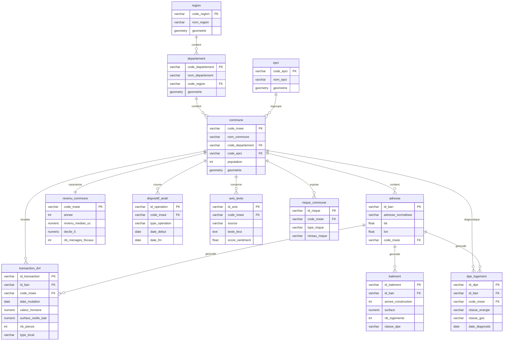

# Homepedia — Schéma relationnel v2

**Sources couvertes**: v1 + population INSEE, DPE logements, risques retrait-gonflement argiles.
**Vs v1**: +2 tables (`dpe_logement`, `risque_commune`). Champ `population` de `commune` reste inchangé (juste alimenté par source INSEE au lieu d'Admin Express).

Clé pivot partout: `code_insee`.

## Tables (reprises de v1, inchangées)

### `region`
| champ | type | note |
|---|---|---|
| code_region (PK) | varchar | |
| nom_region | varchar | |
| geometrie | geometry(polygon) | Admin Express |

### `departement`
| champ | type | note |
|---|---|---|
| code_departement (PK) | varchar | |
| nom_departement | varchar | |
| code_region (FK) | varchar | → region |
| geometrie | geometry(polygon) | Admin Express |

### `epci`
| champ | type | note |
|---|---|---|
| code_epci (PK) | varchar | |
| nom_epci | varchar | |
| geometrie | geometry(polygon) | Admin Express |

### `commune`
| champ | type | note |
|---|---|---|
| code_insee (PK) | varchar | clé pivot globale |
| nom_commune | varchar | |
| code_departement (FK) | varchar | → departement |
| code_epci (FK) | varchar, nullable | → epci |
| population | int | INSEE (source précisée v2) |
| geometrie | geometry(polygon) | Admin Express |

### `adresse` (BAN)
| champ | type | note |
|---|---|---|
| id_ban (PK) | varchar | |
| adresse_normalisee | varchar | |
| lat, lon | float | |
| code_insee (FK) | varchar | → commune |
| score_matching | float | |

### `transaction_dvf`
| champ | type | note |
|---|---|---|
| id_transaction (PK) | varchar/int | |
| id_ban (FK) | varchar, nullable | → adresse (géocodage) |
| code_insee (FK) | varchar | → commune |
| date_mutation | date | |
| valeur_fonciere | numeric | prix |
| surface_reelle_bati | numeric | |
| nb_pieces | int | |
| type_local | varchar | maison/appartement/terrain |
| ref_cadastrale | varchar | |

### `batiment` (CSTB BDNB)
| champ | type | note |
|---|---|---|
| id_batiment (PK) | varchar | |
| id_ban (FK) | varchar, nullable | → adresse |
| annee_construction | int | |
| surface | numeric | |
| nb_logements | int | |
| materiaux | varchar | |
| classe_dpe | varchar | A-G (résumé bâtiment, ≠ table dpe_logement détaillée) |

### `revenu_commune` (Filosofi/INSEE)
| champ | type | note |
|---|---|---|
| code_insee (PK, FK) | varchar | → commune |
| annee | int | |
| revenu_median_uc | numeric | |
| decile_1..decile_9 | numeric | |
| nb_menages_fiscaux | int | |
| taux_pauvrete | numeric, nullable | |

### `dispositif_anah`
| champ | type | note |
|---|---|---|
| id_operation (PK) | varchar | |
| code_insee (FK) | varchar | → commune |
| type_operation | varchar | OPAH / PIG / Habiter Mieux |
| date_debut, date_fin | date | |
| nb_logements_renoves | int, nullable | |
| montant_aides | numeric, nullable | |

### `aide_renovation` (Mes Aides Réno)
| champ | type | note |
|---|---|---|
| id_simulation (PK) | varchar | |
| code_insee (FK) | varchar | → commune |
| revenu_foyer | numeric | input |
| type_logement | varchar | input |
| montant_aide_estime | numeric | output API |

### `avis_texte` (cf. NoSQL)
| champ | type | note |
|---|---|---|
| id_avis (PK) | varchar | |
| code_insee (FK) | varchar | → commune |
| source | varchar | Google/TripAdvisor |
| texte_brut | text | |
| date_avis | date | |
| score_sentiment | float | calculé NLP |
| mots_cles | jsonb/array | extraits NLP |

## Nouvelles tables v2

### `dpe_logement` (ADEME)
| champ | type | note |
|---|---|---|
| id_dpe (PK) | varchar | |
| id_ban (FK) | varchar, nullable | → adresse |
| code_insee (FK) | varchar | → commune |
| classe_energie | varchar | A-G |
| classe_ges | varchar | A-G, émissions gaz à effet de serre |
| date_diagnostic | date | |
| surface_logement | numeric | |
| type_logement | varchar | maison/appartement |

Distincte de `batiment.classe_dpe` (CSTB, résumé statique du bâtiment) — ici diagnostic individuel par logement, plus précis, permet analyse par transaction DVF.

### `risque_commune` (Géorisques)
| champ | type | note |
|---|---|---|
| id_risque (PK) | varchar | |
| code_insee (FK) | varchar | → commune |
| type_risque | varchar | argile / inondation / séisme... (extensible) |
| niveau_risque | varchar | faible/moyen/fort |
| source | varchar | ex: "carte retrait-gonflement argiles" |

Table générique pensée pour accueillir d'autres risques Géorisques plus tard sans nouvelle table (juste nouvelles lignes `type_risque`).

## Relations (clé de jointure = code_insee)

```
region 1—N departement 1—N commune N—1 epci
commune 1—N adresse (BAN)
commune 1—N transaction_dvf
adresse 1—N transaction_dvf (via id_ban, optionnel)
adresse 1—N batiment (via id_ban, optionnel)
commune 1—1 revenu_commune (par année)
commune 1—N dispositif_anah
commune 1—N avis_texte
commune 1—N dpe_logement
adresse 1—N dpe_logement (via id_ban, optionnel)
commune 1—N risque_commune
```

## Diagramme



## Répartition SQL / NoSQL
- **Relationnel (PostgreSQL/PostGIS)**: region, departement, epci, commune, adresse, transaction_dvf, batiment, revenu_commune, dispositif_anah, dpe_logement, risque_commune
- **Non-relationnel (MongoDB/Elasticsearch)**: avis_texte
