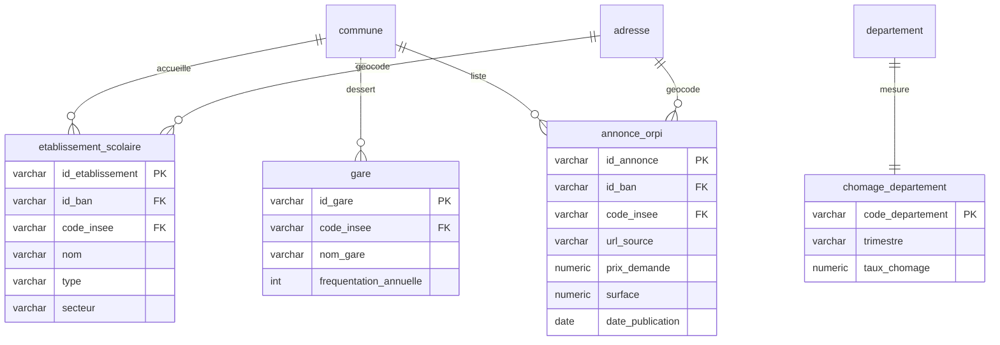

# Homepedia — Schéma relationnel v3

**Sources couvertes**: v2 + établissements d'enseignement, gares SNCF, chômage INSEE, annonces Orpi (scraping).
**Vs v2**: +3 tables (`etablissement_scolaire`, `gare`, `chomage_departement`) +1 table scraping (`annonce_orpi`). BAN (`adresse`) déjà présente depuis v1, pas de changement structurel — juste confirmation qu'on l'exploite pleinement comme clé de géocodage pour ces nouvelles sources.

Clé pivot: `code_insee` (commune) ou `code_departement` (chômage, niveau zone d'emploi/département).

## Tables (reprises de v2, inchangées)

Voir [v2/Schema_relationnel.md](../v2/Schema_relationnel.md) pour détail complet: `region`, `departement`, `epci`, `commune`, `adresse`, `transaction_dvf`, `batiment`, `revenu_commune`, `dispositif_anah`, `aide_renovation`, `avis_texte`, `dpe_logement`, `risque_commune`.

## Nouvelles tables v3

### `etablissement_scolaire` (Éducation nationale)
| champ | type | note |
|---|---|---|
| id_etablissement (PK) | varchar | |
| id_ban (FK) | varchar, nullable | → adresse |
| code_insee (FK) | varchar | → commune |
| nom | varchar | |
| type | varchar | école / collège / lycée |
| secteur | varchar | public / privé |
| lat, lon | float | |

*Intérêt*: indicateur infra/éducation, critère d'attractivité pour familles.

### `gare` (SNCF)
| champ | type | note |
|---|---|---|
| id_gare (PK) | varchar | |
| code_insee (FK) | varchar | → commune |
| nom_gare | varchar | |
| lat, lon | float | |
| frequentation_annuelle | int, nullable | dataset Fréquentation en gares |

*Intérêt*: indicateur accessibilité/transport, corrèle avec prix (effet proximité gare).

### `chomage_departement` (INSEE)
| champ | type | note |
|---|---|---|
| code_departement (PK, FK) | varchar | → departement |
| trimestre | varchar | ex: "2026T2" |
| taux_chomage | numeric | |

Niveau département/zone d'emploi (pas commune — donnée INSEE non disponible à cette granularité). *Intérêt*: 2e indicateur économique, complète le revenu pour analyse socio-éco par territoire.

### `annonce_orpi` (scraping — source non-officielle, usage académique)
| champ | type | note |
|---|---|---|
| id_annonce (PK) | varchar | |
| id_ban (FK) | varchar, nullable | → adresse |
| code_insee (FK) | varchar, nullable | → commune |
| url_source | varchar | traçabilité scraping |
| prix_demande | numeric | ≠ valeur_fonciere DVF (prix demandé vs prix réel vendu) |
| surface | numeric | |
| nb_pieces | int | |
| type_bien | varchar | |
| date_publication | date | |
| date_scraping | timestamp | traçabilité |

*Intérêt*: complète DVF (transactions passées) avec offre actuelle du marché — permet comparer prix demandé vs prix réellement vendu (indicateur tension marché). Scraping toléré usage académique uniquement (cf. avertissement sujet, ToS Orpi à respecter).

## Relations ajoutées v3

```
commune 1—N etablissement_scolaire
adresse 1—N etablissement_scolaire (via id_ban, optionnel)
commune 1—N gare
departement 1—1 chomage_departement (par trimestre)
commune 1—N annonce_orpi
adresse 1—N annonce_orpi (via id_ban, optionnel)
```

## Diagramme (nouvelles tables uniquement — reste identique à v2)



## Répartition SQL / NoSQL
- **Relationnel (PostgreSQL/PostGIS)**: toutes tables v1+v2 + `etablissement_scolaire`, `gare`, `chomage_departement`, `annonce_orpi`
- **Non-relationnel (MongoDB/Elasticsearch)**: `avis_texte` (inchangé, cf. v1/Schema_nosql.md)

## Note scraping
`annonce_orpi` distincte de `transaction_dvf`: source non-officielle, données volatiles (annonce peut disparaître), champs `url_source`/`date_scraping` obligatoires pour traçabilité et audit méthodologie (exigé par le sujet).
