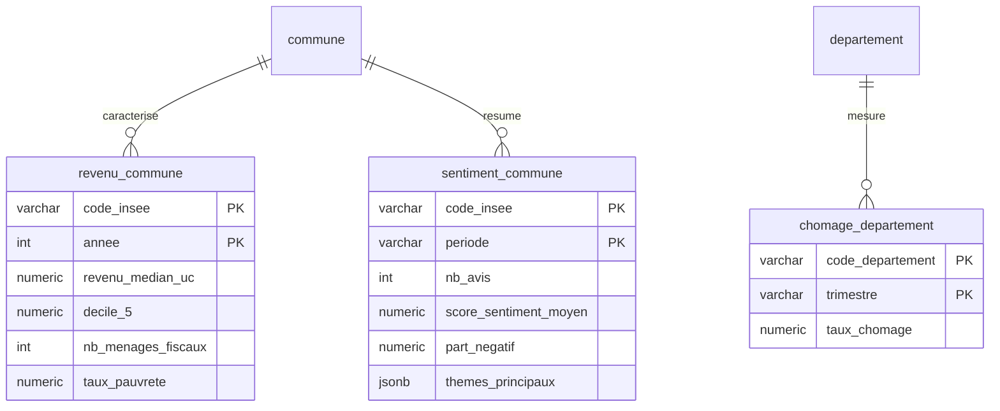

# Homepedia — Schéma relationnel v4

**Sources couvertes**: identiques à v3 (pas de nouvelle source).
**Vs v3**: version de correction, pas d'ajout de source.
- `avis_texte` **retirée du relationnel** → les avis vivent uniquement dans MongoDB (collection `avis`, cf. [v1/Schema_nosql.md](../v1/Schema_nosql.md)). Remplacée côté SQL par un agrégat `sentiment_commune`.
- `revenu_commune`: PK `code_insee` → PK composite `(code_insee, annee)`. Relation commune 1—N (une ligne par année).
- `chomage_departement`: PK `code_departement` → PK composite `(code_departement, trimestre)`. Relation departement 1—N (une ligne par trimestre).
- `aide_renovation`: statut clarifié → stockée en SQL comme cache des simulations API (auparavant ambigu: "pas stocké tel quel" en v1, absente de la répartition v1/v2).

Clé pivot: `code_insee` (commune), `code_departement` (chômage).

## Tables inchangées

Voir [v2/Schema_relationnel.md](../v2/Schema_relationnel.md): `region`, `departement`, `epci`, `commune`, `adresse`, `transaction_dvf`, `batiment`, `dispositif_anah`, `aide_renovation`, `dpe_logement`, `risque_commune`.

Voir [v3/Schema_relationnel.md](../v3/Schema_relationnel.md): `etablissement_scolaire`, `gare`, `annonce_orpi`.

## Tables modifiées v4

### `revenu_commune` (Filosofi/INSEE)
| champ | type | note |
|---|---|---|
| code_insee (PK, FK) | varchar | → commune |
| annee (PK) | int | millésime Filosofi |
| revenu_median_uc | numeric | |
| decile_1..decile_9 | numeric | |
| nb_menages_fiscaux | int | |
| taux_pauvrete | numeric, nullable | |

*Pourquoi*: Filosofi publie un millésime par an. Avec `code_insee` seul en PK, impossible de stocker plusieurs années → pas d'évolution temporelle du revenu.

### `chomage_departement` (INSEE)
| champ | type | note |
|---|---|---|
| code_departement (PK, FK) | varchar | → departement |
| trimestre (PK) | varchar | ex: "2026T2" |
| taux_chomage | numeric | |

*Pourquoi*: série trimestrielle. Avec `code_departement` seul en PK, une seule valeur possible par département → historique perdu.

## Tables supprimées v4

### `avis_texte` → supprimée du relationnel

Les avis bruts + résultats NLP restent **uniquement** dans MongoDB (collection `avis`). Avant v4, ils étaient décrits des deux côtés → risque de double stockage et de désynchronisation.

## Nouvelles tables v4

### `sentiment_commune` (agrégat calculé depuis MongoDB `avis`)
| champ | type | note |
|---|---|---|
| code_insee (PK, FK) | varchar | → commune |
| periode (PK) | varchar | ex: "2026" ou "2026T2" |
| nb_avis | int | taille échantillon (fiabilité) |
| score_sentiment_moyen | numeric | moyenne `nlp.score_sentiment` |
| part_negatif | numeric | % avis `label_sentiment = negatif` |
| themes_principaux | jsonb | top thèmes NLP, ex: `["bruit", "transport"]` |
| date_calcul | timestamp | traçabilité (dernier recalcul) |

*Pourquoi*: l'app a besoin de croiser sentiment × prix × revenu par commune. Faire ce croisement via une table SQL agrégée (calculée par job Spark depuis Mongo) évite des allers-retours Mongo ↔ Postgres à chaque requête. Le texte brut reste en NoSQL, seul le résumé chiffré passe en SQL.

## Relations modifiées v4

```
commune 1—N revenu_commune        (par année — était 1—1)
departement 1—N chomage_departement (par trimestre — était 1—1)
commune 1—N sentiment_commune     (par période — nouveau)
commune 1—N avis_texte            (supprimée — avis en MongoDB, lien via code_insee)
```

## Diagramme (tables modifiées/nouvelles uniquement)



## Répartition SQL / NoSQL (complète)
- **Relationnel (PostgreSQL/PostGIS)** — 17 tables: `region`, `departement`, `epci`, `commune`, `adresse`, `transaction_dvf`, `batiment`, `revenu_commune`, `dispositif_anah`, `aide_renovation`, `dpe_logement`, `risque_commune`, `etablissement_scolaire`, `gare`, `chomage_departement`, `annonce_orpi`, `sentiment_commune`
- **Non-relationnel (MongoDB)** — collection `avis` (+ `documents_bruts` en option staging). Inchangé, cf. [v1/Schema_nosql.md](../v1/Schema_nosql.md).

## Flux avis (clarifié)
```
scraping → MongoDB avis (texte brut) → NLP → MongoDB avis.nlp → job Spark d'agrégation → PostgreSQL sentiment_commune → app
```
